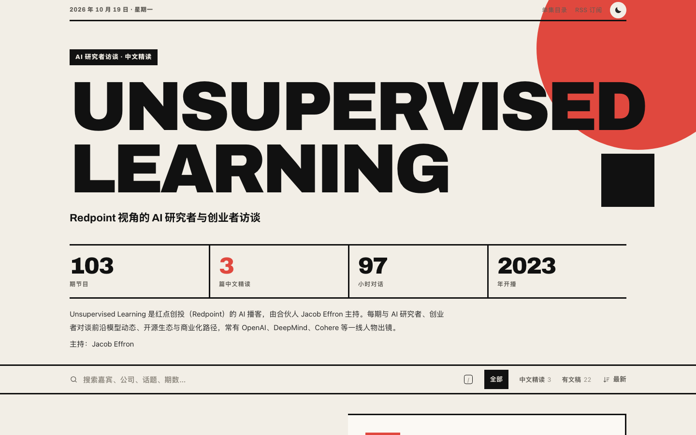
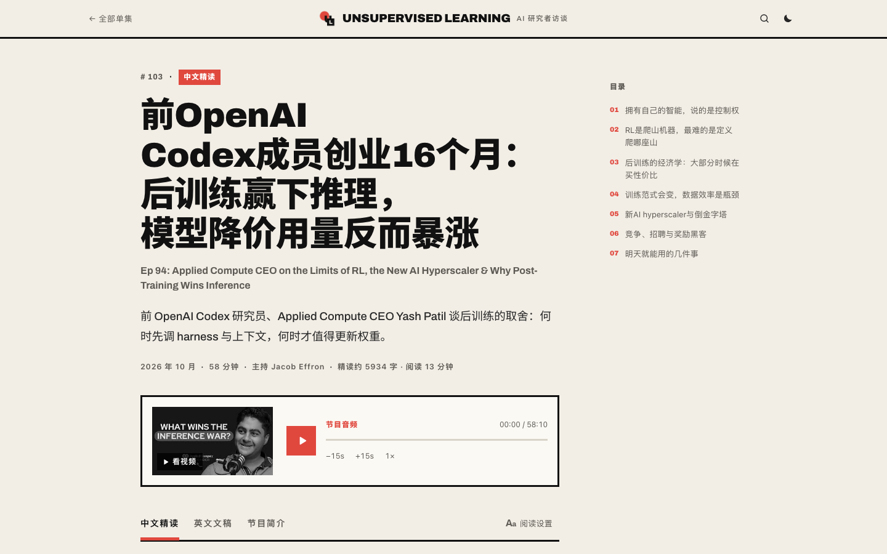
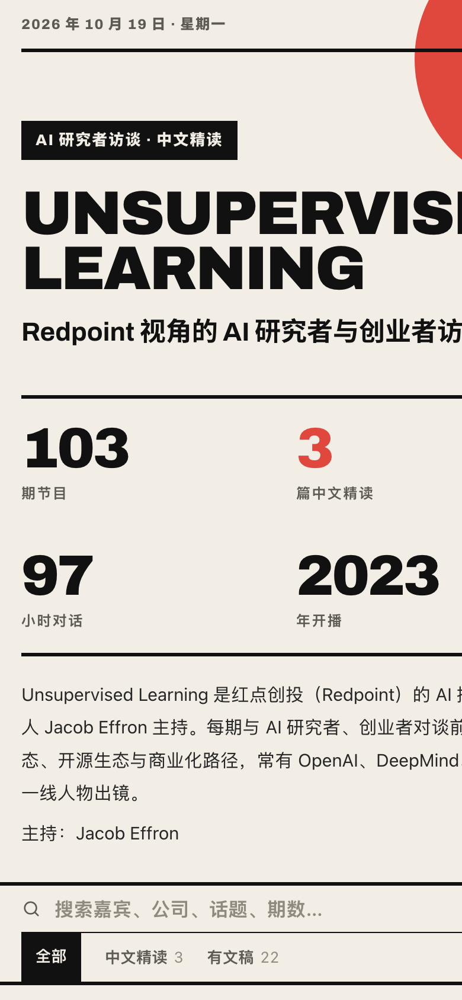

# Unsupervised Learning 中文精读 · AI 研究者访谈

**中文** | [English](#english)



> 把 Unsupervised Learning 全部 103 期节目做成一个可以认真读的中文站：每期一个页面，中文标题与简介、节目音频与视频、英文文稿，以及 103 篇 AI 改写的中文长文精读。
>
> A Chinese reading companion for **Unsupervised Learning with Jacob Effron | Redpoint** — every episode gets its own page with a Chinese title and summary, audio, video, transcript, and (for 103 episodes so far) a long-form Chinese deep read.

[**在线访问 unsupervised.qiaomu.ai**](https://unsupervised.qiaomu.ai/) · [RSS 全文订阅](https://unsupervised.qiaomu.ai/feed.xml) · [单集目录](https://unsupervised.qiaomu.ai/archive/) · [llms.txt](https://unsupervised.qiaomu.ai/llms.txt) · [MIT License](LICENSE)

**已验证：** `python3 scripts/sitegen/build.py` 本地完整构建 103 个单集页 · 线上 https://unsupervised.qiaomu.ai/ 已部署

## 这是什么

Unsupervised Learning 是红点创投（Redpoint）的 AI 播客，由合伙人 Jacob Effron 主持。每期与 AI 研究者、创业者对谈前沿模型动态、开源生态与商业化路径，常有 OpenAI、DeepMind、Cohere 等一线人物出镜。

这个仓库是它的非官方中文站点 **[unsupervised.qiaomu.ai](https://unsupervised.qiaomu.ai/)** 的全部源码与中文内容：一个零依赖的静态站生成器，加上节目元数据、103 期中文标题翻译和 103 篇中文精读。

## 核心能力

| 能力 | 读者得到什么 |
|---|---|
| 中文标题与简介 | 每一期都有准确的中文标题和一句话简介，扫一眼就知道值不值得听 |
| 中文精读 | 一两个小时的对话压缩成一篇中文长文：小节编号、摘句、首字下沉、文末致读者 |
| 阅读设置 | 浅色 / 护眼 / 深色，5 种开源中文字体（思源黑体、思源宋体、霞鹜文楷、站酷小薇），字号、行距、版心、首行缩进 |
| 目录与进度 | 宽屏侧栏目录（与正文一起居中）、滚动高亮、阅读进度条、记住读到哪 |
| 音频播放器 | 断点续听、倍速记忆、悬浮迷你播放条、空格 / 方向键快捷键 |
| 搜索 | 中英文归一化、多词组合、嘉宾优先排序、关键词高亮、`/` 或 ⌘K 聚焦、结果可分享 |
| 继续收听 / 阅读 | 首页自动列出你没听完、没读完的单集 |
| RSS 全文订阅 | 最新 30 期，中文精读全文 + 节目音频 |
| SEO / GEO | 首屏预渲染、Article / PodcastEpisode 结构化数据、每篇精读的 Markdown 版、llms.txt、sitemap、欢迎 AI 检索爬虫 |
| 分享卡片 | 每期一张 1200×630 的定制分享图，人像按人脸位置裁切，标题按标点均衡断行 |
| PWA | 可安装为应用，读过的文章离线可读，自带离线页与 404 页 |

## 视觉风格

本站是同一套引擎下的四个姊妹站之一，每站一种独立视觉。**Unsupervised Learning** 的方向是 **包豪斯海报**：Archivo + 思源黑体 Black，米白、纯黑与红，粗黑框、巨号数字与错位投影。

| 首页 | 单集页 | 手机 |
|---|---|---|
|  |  |  |

姊妹站：[No Priors](https://nopriors.qiaomu.ai/) · [Cognitive Revolution](https://cogrev.qiaomu.ai/) · [Training Data](https://trainingdata.qiaomu.ai/) · [Lex Fridman](https://lex.qiaomu.ai/)

## 快速开始

需要 Python 3.10+ 与 Pillow（只用于生成图标和分享卡片）。

```bash
git clone https://github.com/joeseesun/unsupervised-cn.git
cd unsupervised-cn
pip install pillow
python3 scripts/sitegen/build.py          # 生成 sites/unsupervised/
python3 -m http.server 8000 -d sites/unsupervised
```

打开 http://localhost:8000 即可预览。首次构建会下载 OFL 授权的字体（用于分享卡片）和 YouTube 缩略图，之后增量生成。

<details>
<summary>完整数据管线（可选）</summary>

```bash
python3 scripts/parse_rss.py           # 从官方 RSS 更新节目元数据
python3 scripts/translate_titles.py    # 为新增单集生成中文标题与简介（需 Magpie / OpenAI 兼容网关）
python3 scripts/gen_zh.py              # 基于英文文稿生成中文精读（需要本地文稿，未随仓库分发）
```

LLM 密钥从 macOS 钥匙串读取（`security find-generic-password -s qiaomu-llm -a magpie -w`），仓库内不含任何密钥。

</details>

## 项目结构

```
data/unsupervised/episodes.json      节目元数据（来自官方 RSS 与 YouTube）
data/unsupervised/translations.json  中文标题与一句话简介
data/unsupervised/zh/NNN.html        中文精读正文
scripts/sitegen/build.py       静态站生成器：页面、RSS、sitemap、llms.txt、Markdown、PWA
scripts/sitegen/brand.py       图标与分享卡片
scripts/sitegen/themes.py      节目信息与视觉主题配置
scripts/sitegen/static/        共用前端脚本、结构样式与各站主题样式
```

## 版权与边界

- 代码以 MIT 授权；`data/` 中的中文标题、简介与精读为 AI 辅助生成的二次创作，转载请署名并链接对应原文页面。
- 节目音频、视频、英文原稿与节目名称版权归 Unsupervised Learning 及其制作方所有。本仓库**不包含**英文文稿与音频；站点不托管媒体文件，音频与视频均链接官方来源。
- 本站为非官方粉丝站点，与节目方无隶属关系。中文精读由 AI 改写，可能有偏差，请以原节目为准。
- 这是一个展示型项目：欢迎通过 Issue 反馈错误或建议，暂不接受外部 PR。

## 关于向阳乔木

[qiaomu.ai](https://qiaomu.ai) · [博客](https://blog.qiaomu.ai) · [乔木推荐](https://tuijian.qiaomu.ai) · X [@vista8](https://x.com/vista8) · GitHub [@joeseesun](https://github.com/joeseesun) · 微信公众号「向阳乔木推荐看」

如果这个站对你有帮助，欢迎在 [unsupervised.qiaomu.ai](https://unsupervised.qiaomu.ai/) 页脚扫码请作者喝杯咖啡。

---

<a name="english"></a>
# English

**Unsupervised Learning 中文精读** is an unofficial Chinese reading companion for *Unsupervised Learning with Jacob Effron | Redpoint* (hosted by Jacob Effron), live at **https://unsupervised.qiaomu.ai/**.

- **103 episodes**, each with a Chinese title and summary, audio player with resume, YouTube embed, and English transcript where available.
- **103 long-form Chinese deep reads** with a magazine-grade reading experience: section numbering, pull quotes, drop caps, a reading-settings panel (3 themes, 5 open-source Chinese fonts, size / leading / measure / indent), a centered table of contents and reading progress.
- **Search** with normalization, multi-term matching, ranking and highlighting; **continue listening / reading**; **full-text RSS**.
- **SEO / GEO**: server-rendered first screen, `Article` + `PodcastEpisode` JSON-LD, a Markdown version of every deep read, `llms.txt`, sitemap, AI crawlers welcome.
- **Share cards** generated per episode (face-centered portrait crops, punctuation-aware balanced title wrapping), full **PWA** with offline reading, custom 404 and offline pages.
- Visual direction: **Bauhaus poster**. One of four sister sites built on the same engine, each with its own design.

**Try it locally**

```bash
git clone https://github.com/joeseesun/unsupervised-cn.git && cd unsupervised-cn
pip install pillow && python3 scripts/sitegen/build.py
python3 -m http.server 8000 -d sites/unsupervised
```

**Boundaries.** Code is MIT-licensed. Chinese titles, summaries and deep reads are AI-assisted derivative works — please attribute and link back. Audio, video, original transcripts and show names belong to Unsupervised Learning and its producers; this repo ships **no transcripts and no audio**, and the site hosts no media files. Not affiliated with the show. Issues welcome; external PRs are not accepted for now.

Made by [向阳乔木 (@vista8)](https://x.com/vista8).
